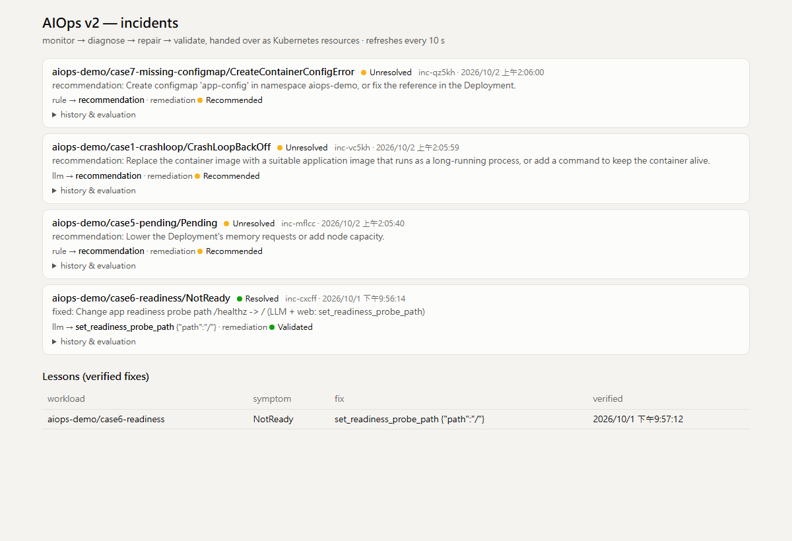
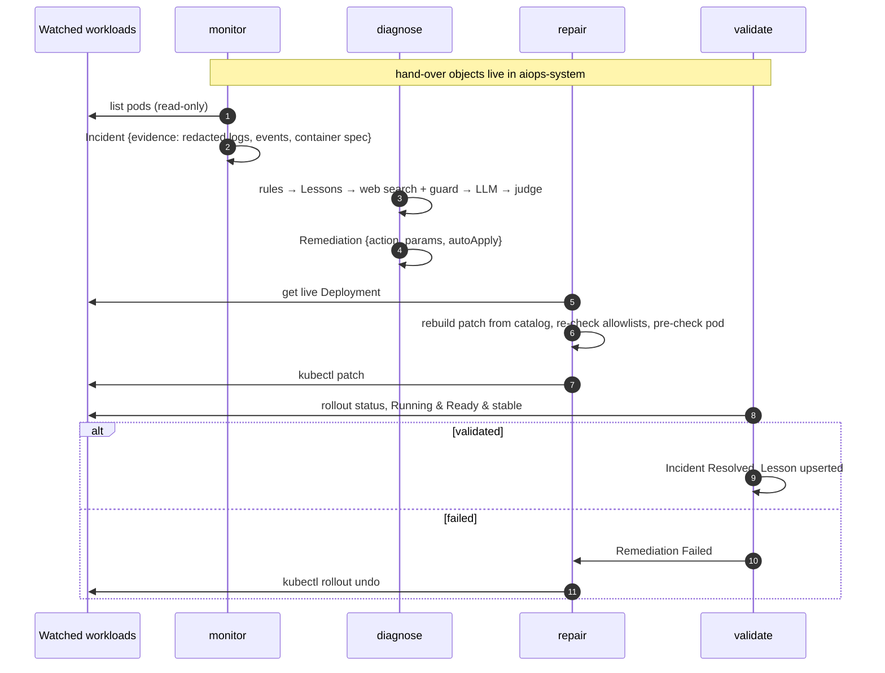
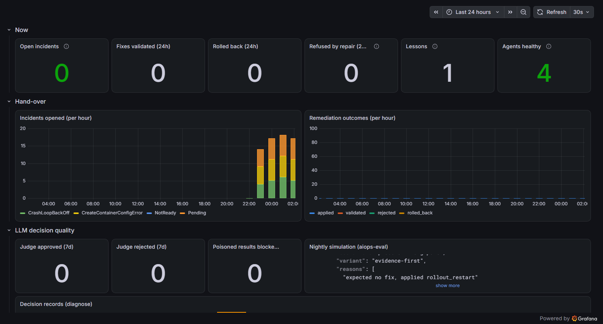

# AIOps v2

**English** | [繁體中文](README.zh-TW.md)

AIOps v2 watches a Kubernetes cluster, finds pods that are failing, works out why, fixes the cause, and checks that the fix worked. Kubernetes is the system that runs your apps as containers in "pods". When an app crashes or never becomes ready, someone normally has to read logs and edit its settings by hand. This project does that automatically.

It is the second version of [KJLavender/AIOps](https://github.com/KJLavender/AIOps). Version 1 is one program that does everything in a single loop. Version 2 splits the job across four small programs ("agents") that each have only the permissions they need. The rules, the list of allowed fixes, the prompt-injection filter, the LLM judge and the test scenarios come from v1. The rest of the home lab around v1 (monitoring, portal, services, fault lab) is still in the v1 repository.



## Why split it into four agents

A single agent has a security problem. The process that reads web search results (untrusted text) also has permission to change Deployments (the objects that describe how an app runs). If the filter has a bug and a search result is poisoned, the agent could apply a bad change.

In v2 each agent runs as its own pod with its own Kubernetes ServiceAccount (an identity with its own permissions). The agents never call each other. They pass work along by creating and updating Kubernetes objects.

- The agent that reads the web and talks to the LLM has no right to change anything in the cluster.
- The agent that changes the cluster has no route to the internet. It never applies a change someone else wrote. It rebuilds the change itself.
- Logs are cleaned of secrets before any other agent sees them, so they cannot leak into a web search.
- Every step is a Kubernetes object with a history. You can read it with `kubectl get incidents,remediations,lessons`.
- Diagnosis and validation run in worker pools, so one slow fix does not block the others.
- An issue that could not be fixed is looked at again only when the workload changes (its Deployment generation changes), or after 6 hours.

## How it works



This is the history of one real fix, taken from `status.history` of a Remediation:

```
13:56:34  Proposed    Change app readiness probe path /healthz -> / (LLM + web)   <- diagnose
13:56:38  Applying    re-checking the proposal against the live cluster           <- repair
13:56:39  Applied     Change app readiness probe path /healthz -> /               <- repair
13:57:11  Validated   Running & Ready & stable                                     <- validate
```

## The four agents

| Agent | What it does | Kubernetes rights (in watched namespaces) | Network |
| --- | --- | --- | --- |
| monitor | Finds failing pods, saves cleaned-up evidence, opens Incidents, removes old ones, serves a read-only web console | Read pods, logs, events, Deployments, ReplicaSets | Kubernetes API only |
| diagnose | Tries rules, then past Lessons, then a guarded web search, then the LLM, then a judge. Writes a Remediation proposal | None | API, Ollama, internet on port 443 |
| repair | Rebuilds the change from the list of allowed actions against the live Deployment, checks it, patches it. Rolls back fixes that fail | Get and patch Deployments, read ReplicaSets and pods | API and pod network (for the pre-check). No internet |
| validate | Waits for the rollout, checks the pod is Running, Ready and stable, records Lessons | Read Deployments, ReplicaSets, pods | API only |

All four use the same image. You pick the role on the command line: `python -m agents <monitor|diagnose|repair|validate>`. They run as non-root with a read-only root filesystem, dropped capabilities and the `RuntimeDefault` seccomp profile.

## The objects they pass around

These are custom resources (CRDs, objects you define yourself). The group is `aiops.homelab.dev/v1alpha1`, and all of them live in the `aiops-system` namespace.

| Kind | Created by | Phases |
| --- | --- | --- |
| `Incident` | monitor | `Open`, `Diagnosing`, `Proposed`, `Remediating`, then `Resolved` or `Unresolved` |
| `Remediation` | diagnose (owned by its Incident) | `Proposed` or `Recommended`, then `Applying`, `Applied`, then `Validated` or `Failed`, then `RolledBack`; or `Rejected` |
| `Lesson` | validate (one per workload and symptom) | none |

```console
$ kubectl get incidents,remediations,lessons -n aiops-system
NAME                                  WORKLOAD                                     PHASE
incident.aiops.homelab.dev/inc-cxcff  aiops-demo/case6-readiness/NotReady          Resolved
incident.aiops.homelab.dev/inc-vc5kh  aiops-demo/case1-crashloop/CrashLoopBackOff  Unresolved

NAME                                     TARGET           SOURCE  ACTION                    PHASE
remediation.aiops.homelab.dev/inc-cxcff  case6-readiness  llm     set_readiness_probe_path  Validated
remediation.aiops.homelab.dev/inc-vc5kh  case1-crashloop  llm                               Recommended

NAME                                          WORKLOAD         SYMPTOM   ACTION
lesson.aiops.homelab.dev/lesson-44255cd418cf  case6-readiness  NotReady  set_readiness_probe_path
```

The `phase` field is the whole coordination protocol. Each agent only picks up objects in the phases it owns, so any agent can restart at any time.

## Security boundaries

These permissions were checked on a running cluster with `kubectl auth can-i` and with real connections from inside each pod:

| | read pod logs | patch Deployments | reach a pod | reach the internet | reach the LLM |
| --- | :-: | :-: | :-: | :-: | :-: |
| monitor | yes | no | no | no | no |
| diagnose | no | no | no | yes | yes |
| repair | no | yes | yes | no | no |
| validate | no | no | no | no | no |

- RBAC (Kubernetes permissions): one ServiceAccount per agent, with namespaced Roles only. [`deploy/generate_rbac.py`](deploy/generate_rbac.py) holds the table and generates `deploy/10-rbac.yaml`. No agent can read Secrets, delete workloads, or touch `kube-system` or `monitoring`.
- NetworkPolicy (firewall rules for pods): everything in `aiops-system` is denied by default, then each agent gets the traffic it needs ([`deploy/30-networkpolicy.yaml`](deploy/30-networkpolicy.yaml)).
- Evidence cleaning: passwords, tokens, bearer and basic auth headers, AWS keys, GitHub tokens, JWTs and `user:pass@` URLs are removed from logs and events. Environment variable values are never copied, only their names.
- No patch is handed over. A Remediation holds an `action` and its `params`, never a patch. The repair agent builds the patch from the live Deployment using the list of allowed actions. A tampered proposal such as `set_image: evil/miner` is refused.

## Checks on fixes the LLM suggests

1. Guard: search results are scanned for prompt injection (instruction overrides, role hijacks, agent directives, `curl | sh`, `privileged`). Flagged results are dropped before the LLM sees them.
2. Short list of actions: the LLM can only name `set_readiness_probe_path`, `rollout_restart`, `lower_requests` or `set_memory_limit`. Each is tied to a symptom and checked afterward. `set_image` and `set_env` exist only for fixed rules and only with values the operator approved.
3. Evidence check and judge: the action must match something in the evidence, and nothing in the evidence may rule it out. For example, a restart is refused when the latest probe failure is "connection refused": nothing listens on that port, and a restart won't change that. This check is plain code and runs even when the judge is turned off. Then a second LLM call grades whether the answer is grounded in the evidence, fits the problem and is safe. It sees only the cluster evidence, and is told that startup noise is normal and the latest events count most.
4. Live pre-check (repair): a new probe path must answer 2xx or 3xx on a running pod before the patch is applied.
5. Validation and rollback: the pod must be Running, Ready and stable, or the change is undone with `rollout undo`. A fix that was rolled back is never proposed or applied again.
6. Lessons: only fixes that passed validation are reused, and only for the same workload.

### About the confidence and judge scores

The LLM reports a confidence for its answer, and the judge gives three scores. Both are numbers the model says about itself. They have not been calibrated against real outcomes, so a 0.9 does not mean the answer is right nine times out of ten. In the nightly runs the model has picked the wrong fix for the wrong-port case with confidence 1.0, and the judge gave that answer 1.0 on every score.

So the thresholds (`AIOPS_LLM_MIN_CONFIDENCE`, `AIOPS_LLM_AUTO_FIX_MIN_CONFIDENCE`, `AIOPS_JUDGE_MIN_SCORE`) only drop answers the model itself is unsure about. What stops a bad change are the checks that don't depend on the LLM: the action list and its parameter checks, the evidence check, the live pre-check, and validation with rollback.

Calibrating the scores (for example with Platt scaling or isotonic regression) needs many past decisions with known outcomes. A home lab doesn't have enough of them yet.

## Metrics and dashboard



- Each agent serves Prometheus metrics at `/metrics`, scraped through a ServiceMonitor. The names are `aiops_incidents_open`, `aiops_incidents_created_total`, `aiops_remediations_total{phase,source}`, `aiops_judge_total`, `aiops_guard_blocked_total`, `aiops_lessons` and `aiops_agent_last_loop_timestamp_seconds`.
- The Grafana dashboard "AIOps v2 (multi-agent)" is in [`deploy/50-dashboard.yaml`](deploy/50-dashboard.yaml). It shows open incidents, outcomes, refusals, lessons, agent health, judge and guard counts, decision records, and each agent's logs from Loki.
- The monitor serves a read-only console (`/` and `/api/state`) that lists every incident with its remediation history and the evaluation behind it.

## Deploy

The setup assumes the home lab from [KJLavender/AIOps](https://github.com/KJLavender/AIOps): k3s, Ollama, kube-prometheus-stack, Loki and Alloy, Traefik, and a `homelab-platform` PriorityClass. The hard requirements are less: a Kubernetes cluster that enforces NetworkPolicy, `kubectl` access, and an Ollama address.

```bash
# 1. Adapt the files to your cluster
#    - deploy/30-networkpolicy.yaml: node IP (192.168.0.16) and pod CIDR (10.42.0.0/16)
#    - deploy/generate_rbac.py: the WATCHED namespaces, then run: python deploy/generate_rbac.py
#    - deploy/20-agents.yaml: AIOPS_NAMESPACES, allowlists, Ollama URL and model, console host

# 2. Build the image (on k3s, import it into containerd)
docker build -t aiops-v2:local .
docker save aiops-v2:local | sudo k3s ctr images import -

# 3. Apply
kubectl apply -f crds/
kubectl apply -f deploy/00-namespace.yaml
kubectl apply -f deploy/10-rbac.yaml -f deploy/30-networkpolicy.yaml
kubectl apply -f deploy/20-agents.yaml -f deploy/40-eval-cronjob.yaml
kubectl apply -f deploy/50-dashboard.yaml        # optional, needs the Grafana sidecar
```

If v1 is also running, scale it down first so two agents do not fix the same pod: `kubectl -n aiops-demo scale deploy/aiops-agent --replicas=0`.

## Try it

Create a broken app from the v1 repository, then watch the objects:

```bash
kubectl apply -f https://raw.githubusercontent.com/KJLavender/AIOps/main/manifests/case6-readiness.yaml
kubectl get incidents,remediations -n aiops-system -w
kubectl describe remediation -n aiops-system <name>     # full history and evaluation
```

You can also open the console at `http://aiops.localhost:8000` (Traefik on the host network).

## Settings

All agents read the same set of environment variables.

| Variable | Default | Used by | Meaning |
| --- | --- | --- | --- |
| `AIOPS_SYSTEM_NAMESPACE` | `aiops-system` | all | Where the objects live |
| `AIOPS_NAMESPACES` / `AIOPS_ALL_NAMESPACES` | `default` / `true` | monitor | What to watch |
| `AIOPS_POLL_INTERVAL` | `15` | all | Seconds between loops |
| `AIOPS_INCIDENT_COOLDOWN` | `600` | monitor | Minimum seconds before an issue is opened again |
| `AIOPS_UNRESOLVED_RECHECK_HOURS` | `6` | monitor | Unfixed and unchanged: look again this often |
| `AIOPS_RETENTION_DAYS` | `7` | monitor | Delete finished incidents after this many days |
| `AIOPS_EVIDENCE_LOG_LINES` | `80` | monitor | Log lines saved as evidence |
| `AIOPS_IMAGE_FALLBACKS` / `AIOPS_ENV_DEFAULTS` | none | diagnose, repair | Values the operator approves |
| `AIOPS_LLM_ENABLED` / `AIOPS_OLLAMA_ENDPOINT` / `AIOPS_OLLAMA_MODEL` | `false` / `http://localhost:11434` / `llama3` | diagnose | The LLM |
| `AIOPS_WEB_SEARCH` / `AIOPS_LLM_AUTO_FIX` | `false` | diagnose | Web search; let the LLM propose actions from the list |
| `AIOPS_JUDGE` / `AIOPS_JUDGE_MIN_SCORE` | `true` / `0.7` | diagnose | The LLM judge |
| `AIOPS_DIAGNOSE_WORKERS` / `AIOPS_VALIDATE_WORKERS` | `2` / `4` | diagnose, validate | Parallel workers |
| `AIOPS_AUTO_FIX` / `AIOPS_DRY_RUN` | `true` / `false` | repair | Apply fixes, or only record them |
| `AIOPS_ACTION_PRECHECK` / `AIOPS_MAX_MEMORY` | `true` / `2Gi` | repair | Pre-check; memory cap |
| `AIOPS_VALIDATION_TIMEOUT` / `AIOPS_STABILITY` | `300` / `60` | validate | Seconds to wait for the rollout; seconds it must stay stable |

## Tests

```bash
pip install pytest
pytest -q                                   # 70 tests, no cluster or network needed, about 0.1 s
python -m agents.simulate --variants default,evidence-first   # needs Ollama
```

The unit tests run all four agents against an in-memory store of the custom resources. They cover a full hand-over (Open, Proposed, Applying, Applied, Validated) and proposals that are tampered with, rolled back, or blocked by the pre-check.

`agents/simulate.py` replays 8 frozen failures through the real diagnose path and the repair checks. They include a poisoned search result, misleading advice, a probe on the wrong port, a slow app, and startup noise before a 404. The `aiops-eval` CronJob runs it every night (cron `30 3 * * *`; it has no Kubernetes rights, and its network access is limited to Ollama and ntfy) and sends a summary to ntfy. The latest result with `qwen3.5:4b` is 8 of 8 passed with 0 unsafe changes.

## Project layout

```
agents/      monitor.py  diagnose.py  repair.py  validate.py  console.py  simulate.py
aiops/       shared code: rules/, llm/, actions.py (allowed actions), guard.py, judge.py,
             websearch.py, evidence.py (capture and cleaning), crd.py (object store), metrics.py
crds/        Incident, Remediation, Lesson
deploy/      namespace, RBAC (generated), agents, NetworkPolicies, eval CronJob, dashboard
tests/       agent hand-over tests, and the shared-code tests from v1
```

## Limitations

- Each agent runs as a single replica. There is no leader election. Restarts are safe because of the phases, but two replicas of the same role would race each other.
- Agents poll with `kubectl` instead of using watches. This is simple and needs no libraries, and is fine for a home lab.
- The confidence and judge scores are not calibrated. See [About the confidence and judge scores](#about-the-confidence-and-judge-scores).
- Not built yet: a human approval step for LLM-proposed fixes, leader election, OpenTelemetry traces, and more allowed actions.

## License

[MIT](LICENSE)
