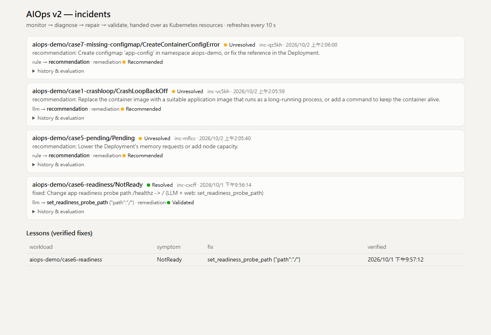
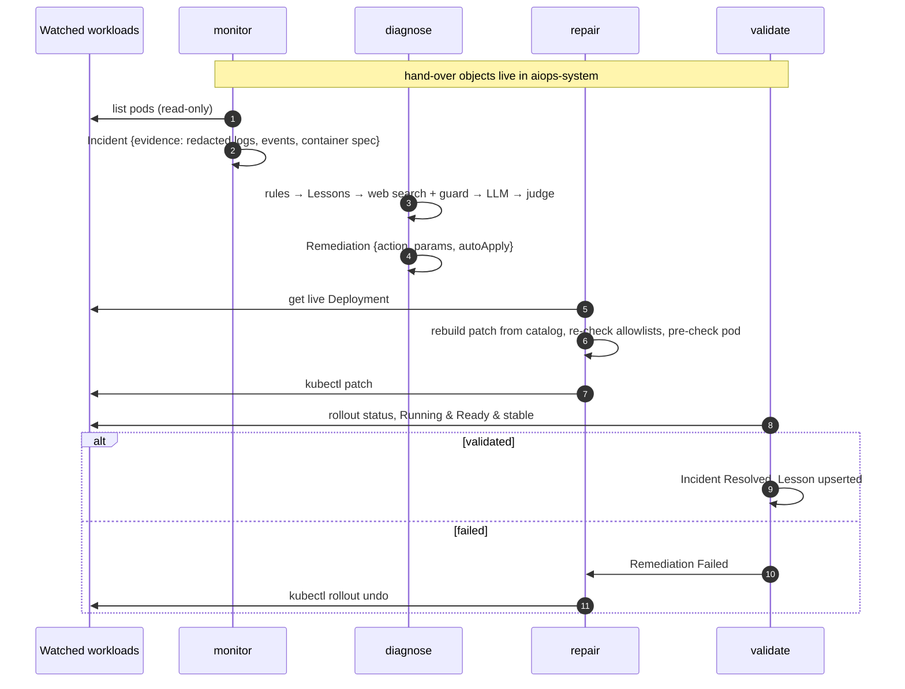
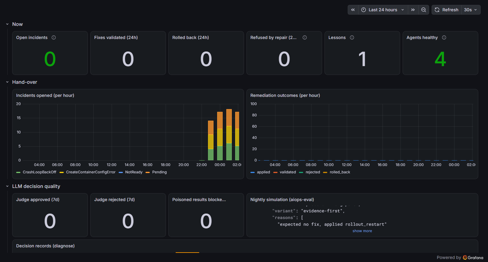

# AIOps v2

[English](README.md) | **繁體中文**

AIOps v2 會監看一個 Kubernetes 叢集，找出出問題的 pod，查出原因、修好它，再確認修復有效。Kubernetes 是把你的應用程式當成容器（放在「pod」裡）來執行的系統。應用程式當掉或一直無法就緒時，通常得有人去看 log、手動改設定。這個專案把這些事自動化。

它是 [KJLavender/AIOps](https://github.com/KJLavender/AIOps) 的第二版。第一版是一支程式，在同一個迴圈裡包辦所有事。第二版把工作拆給四支小程式（「agent」），每支只拿到自己需要的權限。規則、允許的修復動作清單、prompt injection 過濾、LLM 評審和測試情境都沿用 v1。v1 周邊的 home lab（監控、入口網站、服務、故障實驗室）仍在 v1 的 repo 裡。



## 為什麼拆成四個 agent

單一 agent 有個資安問題：讀網路搜尋結果（不可信的文字）的程式，同時也有權限修改 Deployment（描述應用程式怎麼跑的物件）。只要過濾器有 bug、搜尋結果又被人下毒，它就可能套用一個壞的修改。

v2 讓每個 agent 各跑在自己的 pod 裡，用自己的 Kubernetes ServiceAccount（一組有自己權限的身分）。agent 之間不會互相呼叫，而是靠建立和更新 Kubernetes 物件來交接工作。

- 讀網頁、呼叫 LLM 的 agent，沒有權限改動叢集裡的任何東西。
- 能改動叢集的 agent，沒有連上網際網路的路線。它也不會套用別人寫好的修改，而是自己重新組出修改內容。
- log 在交給其他 agent 之前，會先把密碼等機密遮掉，所以不會被帶進網路搜尋。
- 每個步驟都是一個帶有歷史紀錄的 Kubernetes 物件，用 `kubectl get incidents,remediations,lessons` 就能查。
- 診斷和驗證各有 worker pool 同時處理，一個慢的修復不會擋住其他的。
- 沒辦法修好的問題，只有在工作負載變動（Deployment 的 generation 變了）或隔 6 小時後，才會重新檢查。

## 運作流程



下面是一次真實修復的紀錄，取自某個 Remediation 的 `status.history`：

```
13:56:34  Proposed    Change app readiness probe path /healthz -> / (LLM + web)   <- diagnose
13:56:38  Applying    re-checking the proposal against the live cluster           <- repair
13:56:39  Applied     Change app readiness probe path /healthz -> /               <- repair
13:57:11  Validated   Running & Ready & stable                                     <- validate
```

## 四個 agent

| Agent | 做什麼 | Kubernetes 權限（在被監看的 namespace） | 網路 |
| --- | --- | --- | --- |
| monitor | 找出出問題的 pod，存下清理過的證據，開 Incident，刪除舊的，並提供唯讀的網頁 console | 讀 pod、log、event、Deployment、ReplicaSet | 只連 Kubernetes API |
| diagnose | 依序試規則、過去的 Lesson、受保護的網路搜尋、LLM，最後交給評審。寫出 Remediation 提案 | 無 | API、Ollama、對外 443 port |
| repair | 針對現況的 Deployment，依允許動作清單重新組出修改，檢查後再 patch。修復失敗時回滾 | 讀取並 patch Deployment，讀 ReplicaSet 和 pod | API 和 pod 網路（做預先檢查）。不能上網 |
| validate | 等 rollout 完成，確認 pod 是 Running、Ready 且穩定，記錄 Lesson | 讀 Deployment、ReplicaSet、pod | 只連 API |

四個 agent 用同一個映像檔，啟動時在命令列指定角色：`python -m agents <monitor|diagnose|repair|validate>`。它們以非 root 執行，根目錄唯讀，移除多餘的 capabilities，並使用 `RuntimeDefault` seccomp。

## 它們傳遞的物件

這些是自訂資源（CRD，自己定義的 Kubernetes 物件）。群組是 `aiops.homelab.dev/v1alpha1`，全都放在 `aiops-system` namespace。

| 種類 | 由誰建立 | 階段（phase） |
| --- | --- | --- |
| `Incident` | monitor | `Open`、`Diagnosing`、`Proposed`、`Remediating`，最後是 `Resolved` 或 `Unresolved` |
| `Remediation` | diagnose（歸屬於對應的 Incident） | `Proposed` 或 `Recommended`，接著 `Applying`、`Applied`，再來是 `Validated` 或 `Failed`，然後 `RolledBack`；或是 `Rejected` |
| `Lesson` | validate（每個工作負載加症狀一筆） | 無 |

```console
$ kubectl get incidents,remediations,lessons -n aiops-system
NAME                                  WORKLOAD                                     PHASE
incident.aiops.homelab.dev/inc-cxcff  aiops-demo/case6-readiness/NotReady          Resolved
incident.aiops.homelab.dev/inc-vc5kh  aiops-demo/case1-crashloop/CrashLoopBackOff  Unresolved

NAME                                     TARGET           SOURCE  ACTION                    PHASE
remediation.aiops.homelab.dev/inc-cxcff  case6-readiness  llm     set_readiness_probe_path  Validated
remediation.aiops.homelab.dev/inc-vc5kh  case1-crashloop  llm                               Recommended

NAME                                          WORKLOAD         SYMPTOM   ACTION
lesson.aiops.homelab.dev/lesson-44255cd418cf  case6-readiness  NotReady  set_readiness_probe_path
```

`phase` 欄位就是整套協調機制。每個 agent 只處理自己負責的階段的物件，所以任何一個 agent 隨時重啟都沒關係。

## 安全邊界

以下權限已在實際運作的叢集上，用 `kubectl auth can-i` 以及從每個 pod 內部實際連線的方式檢查過：

| | 讀 pod log | patch Deployment | 連到 pod | 連到網際網路 | 連到 LLM |
| --- | :-: | :-: | :-: | :-: | :-: |
| monitor | 可以 | 不行 | 不行 | 不行 | 不行 |
| diagnose | 不行 | 不行 | 不行 | 可以 | 可以 |
| repair | 不行 | 可以 | 可以 | 不行 | 不行 |
| validate | 不行 | 不行 | 不行 | 不行 | 不行 |

- RBAC（Kubernetes 的權限）：每個 agent 一個 ServiceAccount，只用限定 namespace 的 Role。權限表寫在 [`deploy/generate_rbac.py`](deploy/generate_rbac.py)，並由它產生 `deploy/10-rbac.yaml`。沒有任何 agent 能讀 Secret、刪除工作負載，或碰 `kube-system` 和 `monitoring`。
- NetworkPolicy（pod 的防火牆規則）：`aiops-system` 內預設全部擋掉，再替每個 agent 開放它需要的連線（[`deploy/30-networkpolicy.yaml`](deploy/30-networkpolicy.yaml)）。
- 證據清理：log 和 event 裡的密碼、token、bearer 與 basic 認證標頭、AWS 金鑰、GitHub token、JWT 和 `user:pass@` 形式的網址都會被移除。環境變數只複製名稱，從不複製值。
- 不傳遞 patch。Remediation 裡只有 `action` 和 `params`，沒有 patch。repair 會依現況的 Deployment 和允許動作清單自己組出 patch，所以被竄改的提案（例如 `set_image: evil/miner`）會被拒絕。

## LLM 建議的修復要過哪些關

1. 過濾器：搜尋結果會先掃描有沒有 prompt injection（覆寫指令、角色劫持、對 agent 下指令、`curl | sh`、`privileged`）。被標記的結果在 LLM 看到之前就丟掉。
2. 短清單：LLM 只能點名 `set_readiness_probe_path`、`rollout_restart`、`lower_requests` 或 `set_memory_limit`。每個動作都對應一種症狀，之後還要驗證。`set_image` 和 `set_env` 只給固定規則用，而且只能用營運者核可的值。
3. 證據比對與評審：動作必須和證據裡的某個訊號相符，而且證據裡不能有排除這個動作的訊號。例如最新一次探針失敗是「connection refused」時，不准重啟：那個 port 根本沒有程式在聽，重啟也不會變好。這一關是單純的程式判斷，就算關掉評審也會執行。接著再呼叫一次 LLM，評估答案是否有證據支持、是否切合問題、是否安全。評審只看叢集的證據，並被告知啟動時的雜訊是正常的，最新的 event 最重要。
4. 即時預先檢查（repair）：新的探針路徑必須在執行中的 pod 上回 2xx 或 3xx，才會 patch。
5. 驗證與回滾：pod 必須 Running、Ready 且穩定，否則用 `rollout undo` 撤銷。被回滾過的修復，不會再被提出或套用。
6. Lesson：只有通過驗證的修復才會被重複使用，而且只用在同一個工作負載。

### 關於信心分數和評審分數

LLM 會替自己的答案報一個信心分數，評審也會打三項分數。這些都是模型自己說的數字，沒有拿實際結果校正過，所以 0.9 不代表十次有九次是對的。在每晚的評測裡，模型曾經在「探針連錯 port」的案例選了錯的修法，信心卻是 1.0，評審也給了三個 1.0。

所以那幾個門檻（`AIOPS_LLM_MIN_CONFIDENCE`、`AIOPS_LLM_AUTO_FIX_MIN_CONFIDENCE`、`AIOPS_JUDGE_MIN_SCORE`）只能擋掉模型自己都沒把握的答案。真正擋住錯誤修改的，是不靠 LLM 判斷的關卡：動作清單和參數檢查、證據比對、即時預先檢查，以及驗證失敗就回滾。

要校正分數（例如用 Platt scaling 或 isotonic regression），需要大量「已知結果」的過去決策。home lab 目前還沒有那麼多資料。

## 指標與儀表板



- 每個 agent 在 `/metrics` 提供 Prometheus 指標，由 ServiceMonitor 抓取。名稱有 `aiops_incidents_open`、`aiops_incidents_created_total`、`aiops_remediations_total{phase,source}`、`aiops_judge_total`、`aiops_guard_blocked_total`、`aiops_lessons` 和 `aiops_agent_last_loop_timestamp_seconds`。
- Grafana 儀表板「AIOps v2 (multi-agent)」放在 [`deploy/50-dashboard.yaml`](deploy/50-dashboard.yaml)。內容有未解決的 incident、處理結果、被拒絕的提案、Lesson、agent 健康狀態、評審與過濾器的次數、決策紀錄，以及從 Loki 來的各 agent log。
- monitor 提供唯讀的 console（`/` 和 `/api/state`），列出每個 incident 的修復歷史和背後的評估。

## 部署

這份設定假設你有 [KJLavender/AIOps](https://github.com/KJLavender/AIOps) 的 home lab：k3s、Ollama、kube-prometheus-stack、Loki 和 Alloy、Traefik，以及一個 `homelab-platform` PriorityClass。硬性需求其實少一些：一個會執行 NetworkPolicy 的 Kubernetes 叢集、`kubectl` 權限，以及一個 Ollama 位址。

```bash
# 1. 依你的叢集調整檔案
#    - deploy/30-networkpolicy.yaml：節點 IP（192.168.0.16）和 pod CIDR（10.42.0.0/16）
#    - deploy/generate_rbac.py：WATCHED 的 namespace，改完執行：python deploy/generate_rbac.py
#    - deploy/20-agents.yaml：AIOPS_NAMESPACES、允許清單、Ollama 網址與模型、console 主機名

# 2. 建置映像檔（k3s 要匯入 containerd）
docker build -t aiops-v2:local .
docker save aiops-v2:local | sudo k3s ctr images import -

# 3. 套用
kubectl apply -f crds/
kubectl apply -f deploy/00-namespace.yaml
kubectl apply -f deploy/10-rbac.yaml -f deploy/30-networkpolicy.yaml
kubectl apply -f deploy/20-agents.yaml -f deploy/40-eval-cronjob.yaml
kubectl apply -f deploy/50-dashboard.yaml        # 選用，需要 Grafana sidecar
```

如果 v1 也在跑，請先把它縮到 0，避免兩個 agent 同時修同一個 pod：`kubectl -n aiops-demo scale deploy/aiops-agent --replicas=0`。

## 試試看

從 v1 的 repo 建立一個壞掉的應用程式，再看這些物件的變化：

```bash
kubectl apply -f https://raw.githubusercontent.com/KJLavender/AIOps/main/manifests/case6-readiness.yaml
kubectl get incidents,remediations -n aiops-system -w
kubectl describe remediation -n aiops-system <name>     # 完整歷史與評估
```

也可以打開 console：`http://aiops.localhost:8000`（Traefik 跑在主機網路上）。

## 設定

所有 agent 讀同一組環境變數。

| 變數 | 預設值 | 使用者 | 說明 |
| --- | --- | --- | --- |
| `AIOPS_SYSTEM_NAMESPACE` | `aiops-system` | 全部 | 物件放在哪裡 |
| `AIOPS_NAMESPACES` / `AIOPS_ALL_NAMESPACES` | `default` / `true` | monitor | 要監看哪些 namespace |
| `AIOPS_POLL_INTERVAL` | `15` | 全部 | 每輪間隔秒數 |
| `AIOPS_INCIDENT_COOLDOWN` | `600` | monitor | 同一個問題再次開單前的最短間隔（秒） |
| `AIOPS_UNRESOLVED_RECHECK_HOURS` | `6` | monitor | 沒修好且沒變動時，多久重新檢查一次 |
| `AIOPS_RETENTION_DAYS` | `7` | monitor | 已結案的 incident 保留幾天 |
| `AIOPS_EVIDENCE_LOG_LINES` | `80` | monitor | 存成證據的 log 行數 |
| `AIOPS_IMAGE_FALLBACKS` / `AIOPS_ENV_DEFAULTS` | 無 | diagnose、repair | 營運者核可的值 |
| `AIOPS_LLM_ENABLED` / `AIOPS_OLLAMA_ENDPOINT` / `AIOPS_OLLAMA_MODEL` | `false` / `http://localhost:11434` / `llama3` | diagnose | LLM |
| `AIOPS_WEB_SEARCH` / `AIOPS_LLM_AUTO_FIX` | `false` | diagnose | 網路搜尋；讓 LLM 從清單中提出修復動作 |
| `AIOPS_JUDGE` / `AIOPS_JUDGE_MIN_SCORE` | `true` / `0.7` | diagnose | LLM 評審 |
| `AIOPS_DIAGNOSE_WORKERS` / `AIOPS_VALIDATE_WORKERS` | `2` / `4` | diagnose、validate | 平行 worker 數 |
| `AIOPS_AUTO_FIX` / `AIOPS_DRY_RUN` | `true` / `false` | repair | 實際套用修復，或只記錄 |
| `AIOPS_ACTION_PRECHECK` / `AIOPS_MAX_MEMORY` | `true` / `2Gi` | repair | 預先檢查；記憶體上限 |
| `AIOPS_VALIDATION_TIMEOUT` / `AIOPS_STABILITY` | `300` / `60` | validate | 等 rollout 的秒數；需要穩定多久（秒） |

## 測試

```bash
pip install pytest
pytest -q                                   # 70 個測試，不需要叢集或網路，約 0.1 秒
python -m agents.simulate --variants default,evidence-first   # 需要 Ollama
```

單元測試讓四個 agent 對著一個放在記憶體裡的自訂資源儲存區運作。涵蓋完整的交接流程（Open、Proposed、Applying、Applied、Validated），以及被竄改、被回滾、被預先檢查擋下的提案。

`agents/simulate.py` 會把 8 個固定的故障案例，丟進真正的 diagnose 流程和 repair 的檢查。案例包括被下毒的搜尋結果、誤導性的建議、探針連錯 port、啟動很慢的應用程式，以及 404 之前的啟動雜訊。`aiops-eval` CronJob 每晚執行一次（cron `30 3 * * *`；它沒有 Kubernetes 權限，網路只能連 Ollama 和 ntfy），並把摘要送到 ntfy。用 `qwen3.5:4b` 的最新結果是 8 個全部通過，沒有不安全的修改。

## 專案結構

```
agents/      monitor.py  diagnose.py  repair.py  validate.py  console.py  simulate.py
aiops/       共用程式：rules/、llm/、actions.py（允許的動作）、guard.py、judge.py、
             websearch.py、evidence.py（擷取與清理）、crd.py（物件儲存）、metrics.py
crds/        Incident、Remediation、Lesson
deploy/      namespace、RBAC（自動產生）、agents、NetworkPolicy、eval CronJob、儀表板
tests/       agent 交接測試，以及沿用自 v1 的共用程式測試
```

## 限制

- 每個 agent 只跑一個副本，沒有 leader election。靠 phase 讓重啟是安全的，但同一個角色跑兩個副本會互相搶。
- agent 用 `kubectl` 輪詢，而不是用 watch。這樣簡單、不需要額外套件，對 home lab 規模夠用。
- 信心分數和評審分數沒有校正過，見[關於信心分數和評審分數](#關於信心分數和評審分數)。
- 還沒做的：對 LLM 提出的修復加上人工核可步驟、leader election、OpenTelemetry trace，以及更多允許的動作。

## 授權

[MIT](LICENSE)
